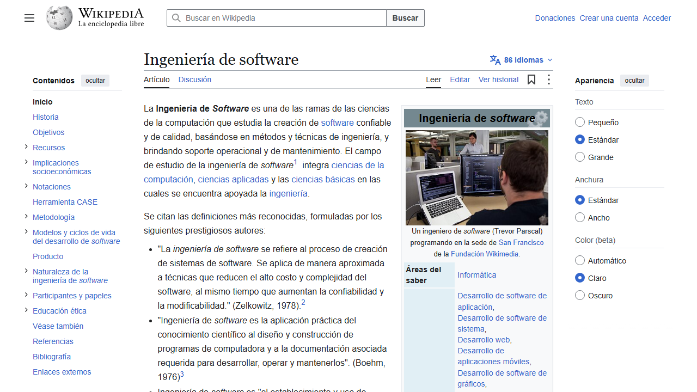
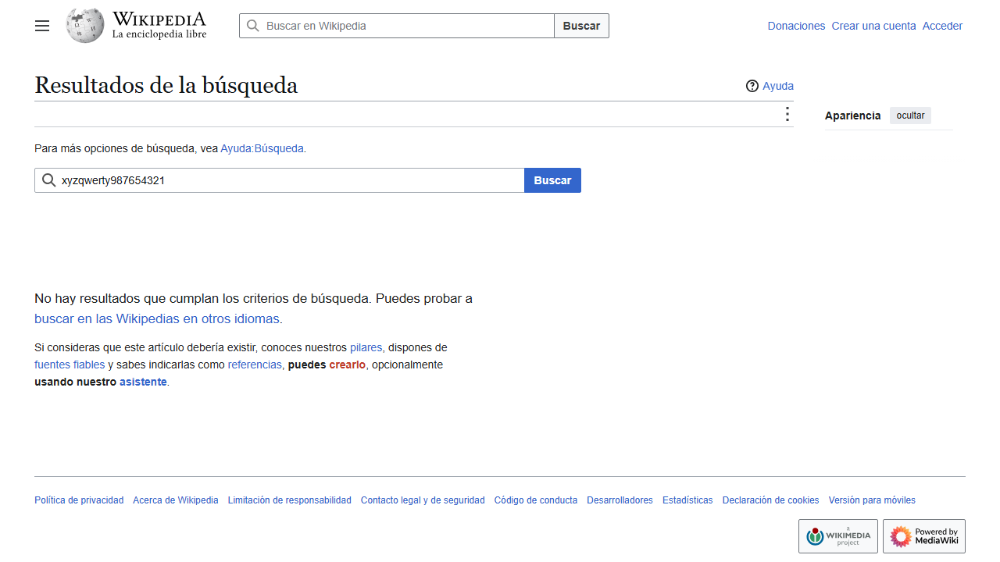
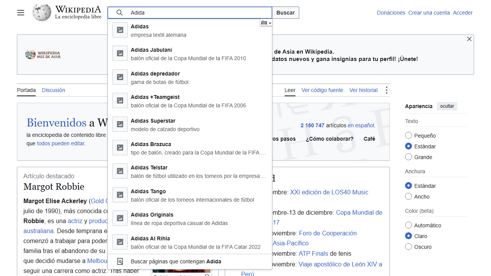
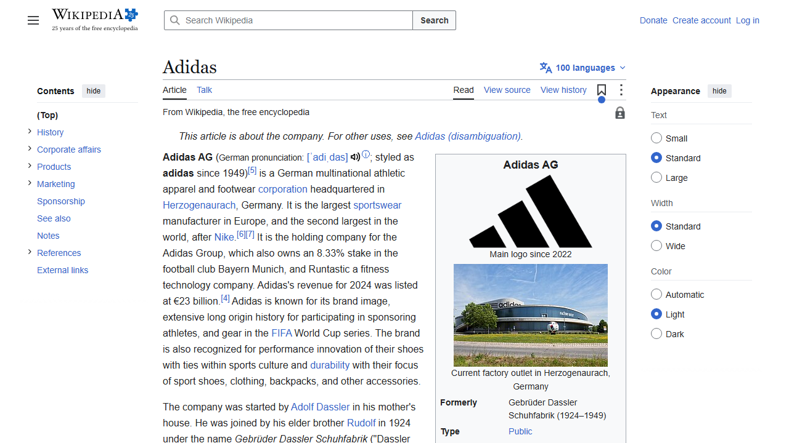
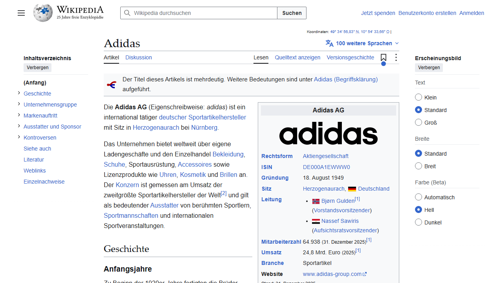
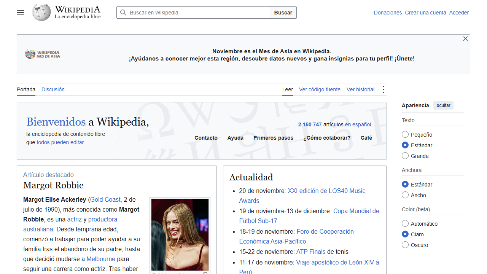
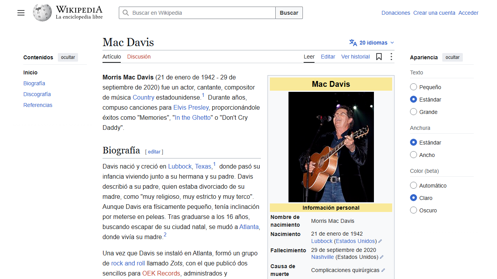
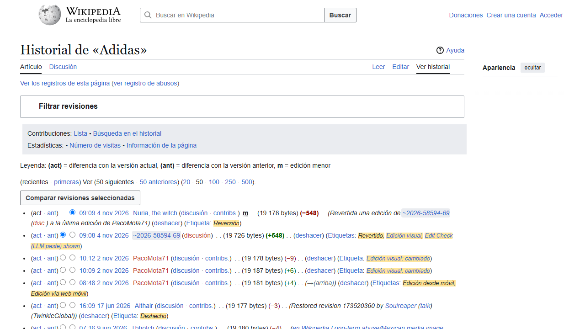
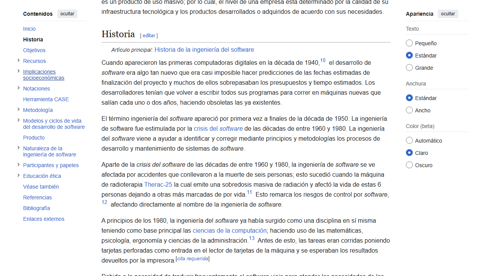

# Laboratorio de Automatización de Pruebas E2E con Playwright y TypeScript

## 👤 Datos del Estudiante
- **Nombre:** andres calderon
- **Asignatura:** Ingeniería de Software III
- **Docente:** Ing. John Alexander Pardo González
- **Herramientas:** Playwright, TypeScript, Node.js, Visual Studio Code, Git/GitHub

---

## 1. 📖 Contexto del Proyecto
En este laboratorio se diseñó e implementó un conjunto completo de **pruebas automatizadas de interfaz gráfica (End-to-End - E2E)** aplicando las mejores prácticas de la ingeniería de software y la calidad de software:

- **Framework de pruebas:** Playwright configurado con TypeScript para tipado estático, modularidad y mantenibilidad.
- **Selectores semánticos y de accesibilidad:** Localizadores precisos (`page.locator`, `getByRole`, selectores de atributos semánticos e interlenguaje).
- **Estructuración y modularización:** Suites organizadas por Historias de Usuario (`test.describe`), precondiciones desacopladas (`test.beforeEach`) y aserciones web explícitas (`toHaveURL`, `toHaveText`, `toContainText`, `toBeVisible`, `toHaveTitle`).
- **Casos de prueba variados:** Pruebas de búsqueda directa, sugerencias dinámicas en vivo (autocompletado reactivo), manejo de búsquedas sin resultados (casos negativos/borde), internacionalización (cambio de idiomas entre Español, Inglés y Alemán), navegación por anclajes de tabla de contenidos e inspección de historial de revisiones.
- **Generación automática de evidencias:** Capturas de pantalla (`screenshots`) generadas al finalizar cada prueba en la carpeta `evidencias/` y reportería en formato HTML.

---

## 2. 🌐 Aplicación Seleccionada: Wikipedia (La Enciclopedia Libre)
Para este taller se seleccionó la plataforma oficial **[Wikipedia en Español](https://es.wikipedia.org/)** (`https://es.wikipedia.org/`).

### ¿Por qué esta plataforma?
1. **Reconocimiento Universal:** Es una de las plataformas web más consultadas, respetadas y conocidas a nivel mundial, lo que permite al docente y a cualquier evaluador reconocer inmediatamente el flujo y el comportamiento esperado.
2. **Estabilidad y Disponibilidad Real:** A diferencia de páginas de retail comercial cerradas (que emplean bloqueadores agresivos tipo Akamai o Cloudflare Turnstile con captchas intermitentes que rompen la integración continua), Wikipedia cuenta con una infraestructura pública de alto rendimiento (MediaWiki / Vector 2022) que permite ejecutar suites de pruebas determinísticas y confiables.
3. **Contenido Rico y Multilingüe:** Permite evaluar funcionalidades avanzadas como internacionalización real (interwikis enlazando versiones en inglés y alemán), sugerencias de autocompletado en tiempo real, tablas de contenido dinámicas e historial de revisiones colaborativas.

---

## 3. 📝 Historias de Usuario

### HU-01: Búsqueda y Localización de Artículos
> **Como** usuario y estudiante consultor de Wikipedia  
> **Quiero** buscar artículos temáticos y de marcas reconocidas mediante la barra de búsqueda  
> **Para** acceder rápidamente a la información requerida y validar sugerencias de autocompletado.

- **Criterio 1 (Búsqueda de marca reconocida - Adidas):** Al buscar "Adidas", el sistema redirige a `/wiki/Adidas`, mostrando el título principal y la ficha técnica corporativa (*Infobox*) con datos de fundación.
- **Criterio 2 (Búsqueda académica - Ingeniería de software):** Al buscar "Ingeniería de software", el sistema redirige al artículo correspondiente, desplegando el primer párrafo introductorio y la tabla de contenidos estructurada.
- **Criterio 3 (Búsqueda sin resultados / Término inexistente):** Al ingresar una cadena sin coincidencias (`xyzqwerty987654321`), el sistema presenta la pantalla informativa `"No hay resultados que cumplan los criterios de búsqueda"`.
- **Criterio 4 (Sugerencias reactivas de autocompletado):** Al ingresar parcialmente una palabra clave ("Adida") sin presionar Enter, el componente de menú flotante despliega sugerencias en vivo con la coincidencia "Adidas".

---

### HU-02: Internacionalización y Multilingüismo (I18n)
> **Como** lector internacional  
> **Quiero** alternar el idioma de lectura de un artículo a sus versiones en otros idiomas  
> **Para** consultar la información en la lengua oficial correspondiente.

- **Criterio 1 (Cambio a versión en Inglés):** Desde el artículo de Adidas en español, al consultar el enlace interidioma a inglés (`en`), se navega exitosamente a `https://en.wikipedia.org/wiki/Adidas` verificando el encabezado en inglés.
- **Criterio 2 (Cambio a versión en Alemán):** Desde el artículo de Adidas en español, al consultar el enlace interidioma al alemán (`de` - país de origen), se navega a `https://de.wikipedia.org/wiki/Adidas`.

---

### HU-03: Navegación Estructural, Historial y Portada
> **Como** usuario habitual de Wikipedia  
> **Quiero** explorar la portada, navegar a artículos aleatorios, revisar el índice y consultar el historial  
> **Para** auditar la trazabilidad de ediciones y acceder ágilmente a distintas secciones.

- **Criterio 1 (Exploración de la Portada oficial):** Al ingresar a `/wiki/Wikipedia:Portada`, se verifica la presencia del logotipo institucional (`.mw-logo`), el título oficial y el saludo de bienvenida.
- **Criterio 2 (Navegación a artículo aleatorio):** Al solicitar `Especial:Aleatoria`, el sistema redirige automáticamente a un artículo existente con título y cuerpo de texto válidos.
- **Criterio 3 (Historial de revisiones):** Al acceder a la pestaña "Ver historial" del artículo de Adidas, se visualiza el registro de ediciones cronológicas con al menos 10 registros históricos, usuarios y fechas.
- **Criterio 4 (Tabla de Contenidos interactiva - TOC):** En el artículo de "Ingeniería de software", al interactuar con un enlace del índice lateral, la URL se actualiza con el ancla de la sección seleccionada.

---

## 4. 🧪 Matriz de Casos de Prueba

| ID | HU | Nombre del Caso de Prueba | Datos de Entrada | Resultado Esperado | Estado |
|:---:|:---:|---|---|---|:---:|
| **CP-01** | HU-01 | Búsqueda directa del artículo Adidas con infobox | `"Adidas"` en el buscador principal | Redirección a `/wiki/Adidas`, encabezado "Adidas" e infobox visible | ✅ Pasó |
| **CP-02** | HU-01 | Búsqueda de artículo temático Ingeniería de software | `"Ingeniería de software"` | Redirección a `/wiki/Ingenier%C3%ADa_de_software` con tabla de contenidos | ✅ Pasó |
| **CP-03** | HU-01 | Manejo de búsqueda sin resultados con término inexistente | `"xyzqwerty987654321"` | Alerta "No hay resultados que cumplan los criterios de búsqueda" | ✅ Pasó |
| **CP-04** | HU-01 | Despliegue interactivo de sugerencias de autocompletado | Texto parcial `"Adida"` | Menú flotante visible con sugerencia de "Adidas" | ✅ Pasó |
| **CP-05** | HU-02 | Cambio de idioma del artículo Adidas a Inglés (English) | Enlace interidioma `hreflang="en"` | Redirección a `en.wikipedia.org/wiki/Adidas` | ✅ Pasó |
| **CP-06** | HU-02 | Cambio de idioma del artículo Adidas a Alemán (Deutsch) | Enlace interidioma `hreflang="de"` | Redirección a `de.wikipedia.org/wiki/Adidas` | ✅ Pasó |
| **CP-07** | HU-03 | Elementos principales de la Portada oficial de Wikipedia | Navegación a `/wiki/Wikipedia:Portada` | Logotipo oficial visible y saludo institucional presente | ✅ Pasó |
| **CP-08** | HU-03 | Navegación a artículo aleatorio (Especial:Aleatoria) | Navegación a `/wiki/Especial:Aleatoria` | Redirección a un artículo con título y párrafos de texto | ✅ Pasó |
| **CP-09** | HU-03 | Consulta del historial de revisiones y versiones | Clic en pestaña "Ver historial" (`#ca-history`) | Pantalla con título "Historial de «Adidas»" y $\ge 10$ revisiones | ✅ Pasó |
| **CP-10** | HU-03 | Navegación mediante la Tabla de Contenidos (TOC) | Clic en sección del índice lateral | URL actualizada con el ancla `#...` de la sección | ✅ Pasó |

---

## 5. 📸 Evidencias de Ejecución

### Módulo HU-01: Búsqueda y Localización de Artículos
#### CP-01: Búsqueda directa del artículo Adidas


#### CP-02: Búsqueda de artículo Ingeniería de software


#### CP-03: Manejo de búsqueda sin resultados


#### CP-04: Sugerencias de autocompletado en vivo


---

### Módulo HU-02: Internacionalización y Multilingüismo (I18n)
#### CP-05: Versión en Inglés (English)


#### CP-06: Versión en Alemán (Deutsch)


---

### Módulo HU-03: Navegación Estructural, Historial y Portada
#### CP-07: Portada oficial de Wikipedia en español


#### CP-08: Artículo aleatorio


#### CP-09: Historial de revisiones de artículo


#### CP-10: Tabla de contenidos interactiva (TOC)


---

## 6. 📁 Estructura del Proyecto

```text
laboratorio-playwright/
├── evidencias/                  # Capturas de pantalla generadas automáticamente
│   ├── CP-01-busqueda-adidas.png
│   ├── CP-02-busqueda-ingenieria-software.png
│   ├── CP-03-busqueda-sin-resultados.png
│   ├── CP-04-sugerencias-en-vivo.png
│   ├── CP-05-idioma-ingles.png
│   ├── CP-06-idioma-aleman.png
│   ├── CP-07-portada-wikipedia.png
│   ├── CP-08-articulo-aleatorio.png
│   ├── CP-09-historial-revisiones.png
│   └── CP-10-tabla-contenidos.png
├── tests/                       # Especificaciones de prueba automatizadas
│   ├── 01-search.spec.ts        # Búsqueda, coincidencia y autocompletado (HU-01)
│   ├── 02-languages.spec.ts     # Internacionalización y cambio de idioma (HU-02)
│   └── 03-navigation.spec.ts    # Portada, artículo aleatorio, historial y TOC (HU-03)
├── package.json                 # Metadatos del proyecto y scripts de ejecución
├── playwright.config.ts         # Configuración central de Playwright (Chromium, baseURL, reportes)
└── README.md                    # Documentación académica del laboratorio
```

---

## 7. 🚀 Cómo Ejecutar las Pruebas Localmente

### Prerrequisitos
- Tener instalado **Node.js** (versión 18 o superior).
- Clonar este repositorio:
  ```bash
  git clone https://github.com/AndresCalCan/laboratorio-playwright.git
  cd laboratorio-playwright
  ```

### Instalación de dependencias
```bash
npm install
npx playwright install chromium
```

### Comandos de ejecución
- **Ejecutar todos los casos de prueba (modo headless):**
  ```bash
  npm test
  ```
- **Ejecutar visualizando el navegador en tiempo real (modo headed):**
  ```bash
  npm run test:headed
  ```
- **Ejecutar en la interfaz interactiva oficial de Playwright:**
  ```bash
  npm run test:ui
  ```
- **Consultar el reporte interactivo HTML:**
  ```bash
  npm run test:report
  ```
