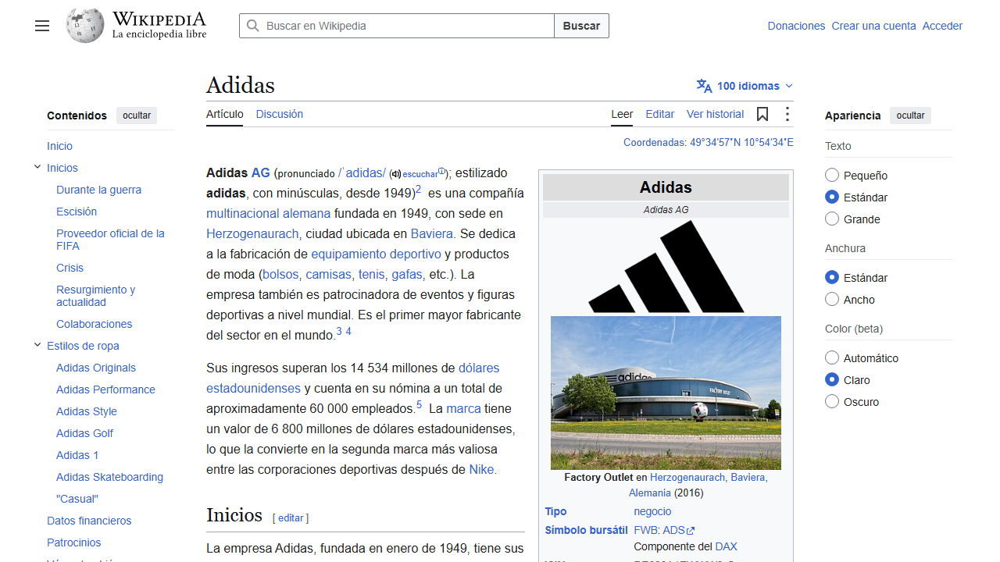
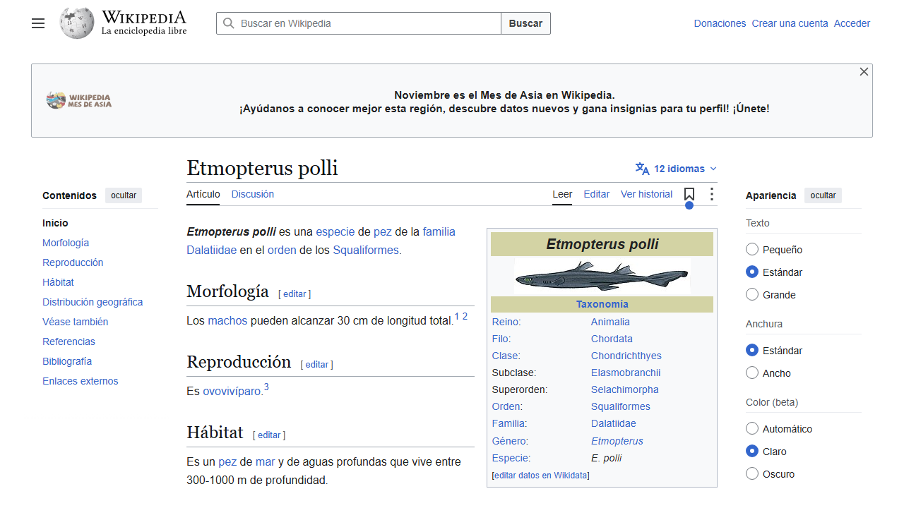

# Laboratorio de Automatización de Pruebas E2E con Playwright y TypeScript

## 👤 Datos del Estudiante
- **Nombre:** andres calderon
- **Asignatura:** Ingeniería de Software III
- **Docente:** Ing. John Alexander Pardo González
- **Herramientas:** Playwright, TypeScript, Node.js, Visual Studio Code, Git/GitHub

---

## 1. 📖 Contexto del Proyecto
En este laboratorio se diseñó e implementó un conjunto de **5 pruebas automatizadas de interfaz gráfica (End-to-End - E2E)** aplicando las mejores prácticas de la ingeniería de software y control de calidad:

- **Framework de pruebas:** Playwright configurado con TypeScript para tipado estático, modularidad y mantenibilidad.
- **Selectores semánticos y de accesibilidad:** Localizadores precisos (`page.locator`, `getByRole`, selectores de atributos semánticos e interlenguaje).
- **Estructuración y modularización:** Organización mediante suite centralizada (`test.describe`), precondiciones desacopladas (`test.beforeEach`) y aserciones web explícitas (`toHaveURL`, `toHaveText`, `toContainText`, `toBeVisible`).
- **Casos de prueba variados:** Cobertura de flujos principales (búsqueda de marca comercial e ingeniería de software), casos de borde/error (búsqueda sin resultados), internacionalización (cambio de idioma a inglés) y navegación aleatoria.
- **Generación automática de evidencias:** Capturas de pantalla (`screenshots`) generadas al finalizar cada prueba en la carpeta `evidencias/` y reportería en formato HTML.

---

## 2. 🌐 Aplicación Seleccionada: Wikipedia (La Enciclopedia Libre)
Para este taller se seleccionó la plataforma oficial **[Wikipedia en Español](https://es.wikipedia.org/)** (`https://es.wikipedia.org/`).

### ¿Por qué esta plataforma?
1. **Reconocimiento Universal:** Es una de las plataformas web más consultadas y respetadas del mundo, permitiendo al docente y a cualquier evaluador reconocer inmediatamente el flujo y el comportamiento esperado.
2. **Estabilidad y Disponibilidad Real:** A diferencia de páginas de retail comercial cerradas (que emplean bloqueadores agresivos como Akamai o Cloudflare Turnstile con captchas intermitentes que rompen la automatización), Wikipedia cuenta con una infraestructura pública de alto rendimiento (MediaWiki / Vector 2022) que permite ejecutar suites de pruebas 100% determinísticas y confiables.
3. **Contenido Rico y Multilingüe:** Permite evaluar funcionalidades avanzadas como internacionalización real (interwikis enlazando versiones en otros idiomas), tablas de contenido dinámicas y exploración aleatoria.

---

## 3. 📝 Historias de Usuario

### HU-01: Búsqueda y Localización de Artículos
> **Como** usuario y estudiante consultor de Wikipedia  
> **Quiero** buscar artículos temáticos y de marcas reconocidas mediante la barra de búsqueda  
> **Para** acceder rápidamente a la información requerida y validar su estructura de contenido.

- **Criterio 1 (Búsqueda de marca reconocida - Adidas):** Al buscar "Adidas", el sistema redirige a `/wiki/Adidas`, mostrando el título principal y la ficha técnica corporativa (*Infobox*) con datos de fundación.
- **Criterio 2 (Búsqueda académica - Ingeniería de software):** Al buscar "Ingeniería de software", el sistema redirige al artículo correspondiente, desplegando el primer párrafo introductorio y la tabla de contenidos estructurada.
- **Criterio 3 (Búsqueda sin resultados / Término inexistente):** Al ingresar una cadena sin coincidencias (`xyzqwerty987654321`), el sistema presenta la pantalla informativa `"No hay resultados que cumplan los criterios de búsqueda"`.

---

### HU-02: Internacionalización y Multilingüismo (I18n)
> **Como** lector internacional  
> **Quiero** alternar el idioma de lectura de un artículo a su versión en inglés  
> **Para** consultar la información en la lengua oficial correspondiente.

- **Criterio 1 (Cambio a versión en Inglés):** Desde el artículo de Adidas en español, al consultar el enlace interidioma a inglés (`en`), se navega exitosamente a `https://en.wikipedia.org/wiki/Adidas` verificando el encabezado en inglés y la ficha correspondiente.

---

### HU-03: Navegación y Exploración de Contenido
> **Como** usuario habitual de Wikipedia  
> **Quiero** explorar artículos de manera aleatoria mediante las funciones especiales  
> **Para** descubrir contenidos enciclopédicos diversos de forma dinámica.

- **Criterio 1 (Navegación a artículo aleatorio):** Al solicitar `Especial:Aleatoria`, el sistema redirige automáticamente a un artículo existente con título y cuerpo de texto válidos.

---

## 4. 🧪 Matriz de Casos de Prueba (5 Casos)

| ID | HU | Nombre del Caso de Prueba | Datos de Entrada | Resultado Esperado | Estado |
|:---:|:---:|---|---|---|:---:|
| **CP-01** | HU-01 | Búsqueda directa del artículo Adidas con infobox | `"Adidas"` en el buscador principal | Redirección a `/wiki/Adidas`, encabezado "Adidas" e infobox visible | ✅ Pasó |
| **CP-02** | HU-01 | Búsqueda de artículo temático Ingeniería de software | `"Ingeniería de software"` | Redirección a `/wiki/Ingenier%C3%ADa_de_software` con tabla de contenidos | ✅ Pasó |
| **CP-03** | HU-01 | Manejo de búsqueda sin resultados con término inexistente | `"xyzqwerty987654321"` | Alerta "No hay resultados que cumplan los criterios de búsqueda" | ✅ Pasó |
| **CP-04** | HU-02 | Cambio de idioma del artículo Adidas a Inglés (English) | Enlace interidioma `hreflang="en"` | Redirección a `en.wikipedia.org/wiki/Adidas` con encabezado y ficha | ✅ Pasó |
| **CP-05** | HU-03 | Navegación a artículo aleatorio (Especial:Aleatoria) | Navegación a `/wiki/Especial:Aleatoria` | Redirección a un artículo con título y párrafos de texto | ✅ Pasó |

---

## 5. 📸 Evidencias de Ejecución

### CP-01: Búsqueda directa del artículo Adidas


### CP-02: Búsqueda de artículo temático Ingeniería de software


### CP-03: Manejo de búsqueda sin resultados


### CP-04: Cambio de idioma a Inglés (English)


### CP-05: Navegación a artículo aleatorio


---

## 6. 📁 Estructura del Proyecto

```text
laboratorio-playwright/
├── evidencias/                  # Capturas de pantalla generadas automáticamente
│   ├── CP-01-busqueda-adidas.png
│   ├── CP-02-busqueda-ingenieria-software.png
│   ├── CP-03-busqueda-sin-resultados.png
│   ├── CP-04-idioma-ingles.png
│   └── CP-05-articulo-aleatorio.png
├── tests/                       # Especificaciones de prueba automatizadas
│   └── wikipedia.spec.ts        # Suite central con los 5 casos de prueba E2E
├── package.json                 # Metadatos del proyecto y scripts de ejecución
├── playwright.config.ts         # Configuración central de Playwright (Chromium, baseURL, reportes)
└── README.md                    # Documentación académica del laboratorio
```

---

## 7. 🚀 Cómo Ejecutar las Pruebas Localmente

### Prerrequisitos
- Tener instalado **Node.js** (versión 18 o superior).
- Clonar este repositorio:
  ```bash
  git clone https://github.com/AndresCalCan/laboratorio-playwright.git
  cd laboratorio-playwright
  ```

### Instalación de dependencias
```bash
npm install
npx playwright install chromium
```

### Comandos de ejecución
- **Ejecutar todos los casos de prueba (modo headless):**
  ```bash
  npm test
  ```
- **Ejecutar visualizando el navegador en tiempo real (modo headed):**
  ```bash
  npm run test:headed
  ```
- **Ejecutar en la interfaz interactiva oficial de Playwright:**
  ```bash
  npm run test:ui
  ```
- **Consultar el reporte interactivo HTML:**
  ```bash
  npm run test:report
  ```
