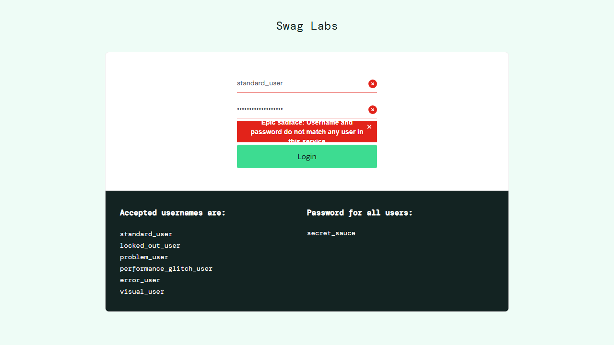
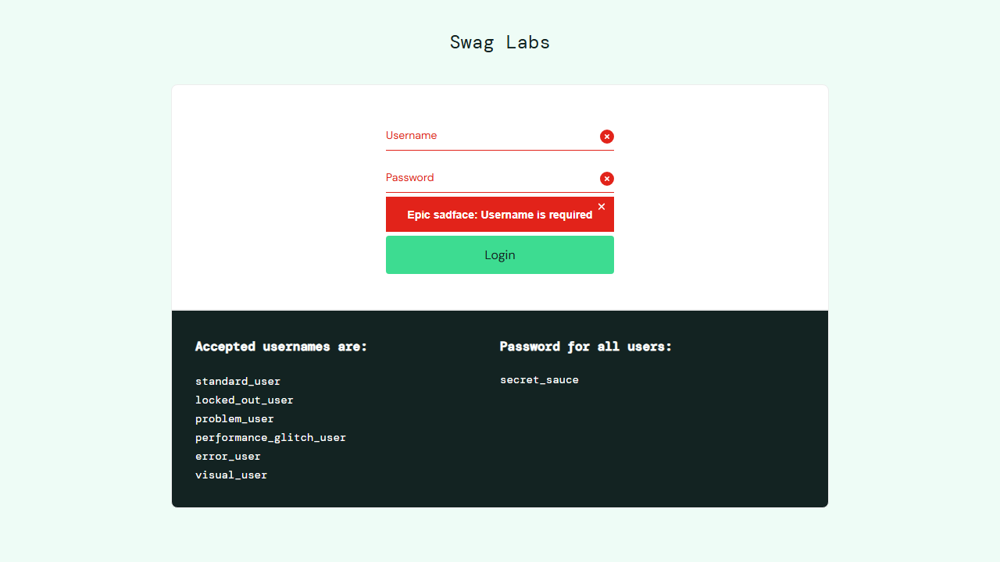
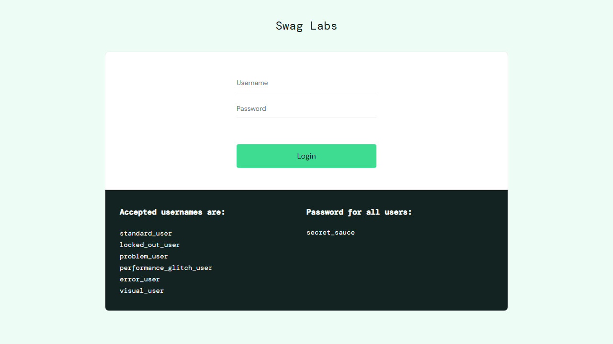
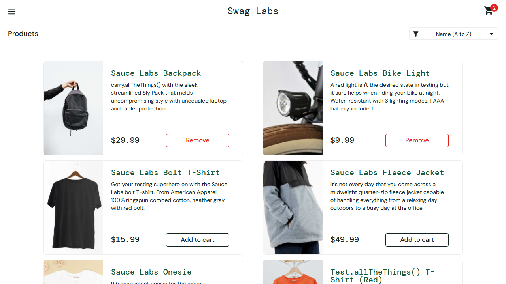
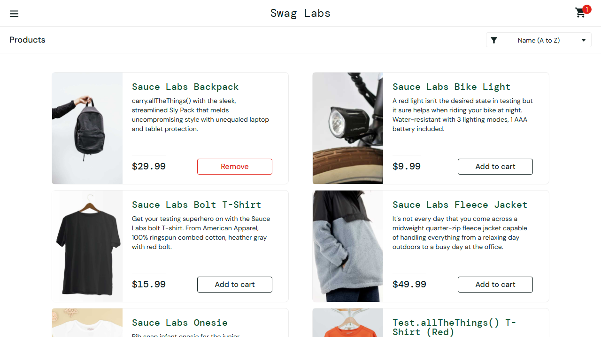
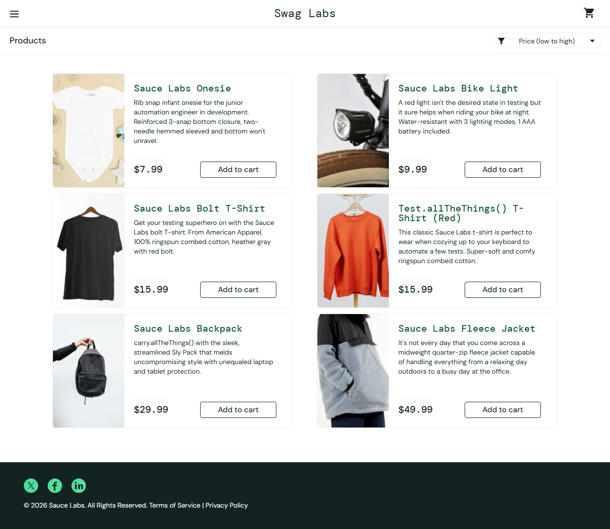
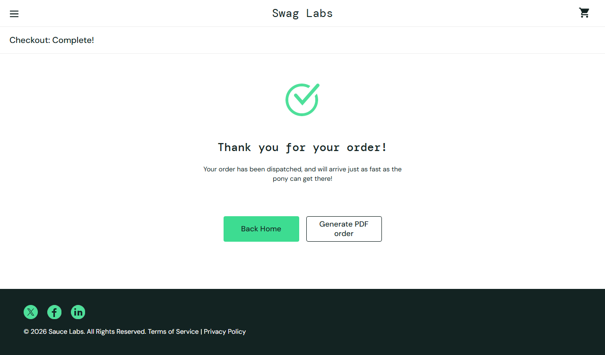
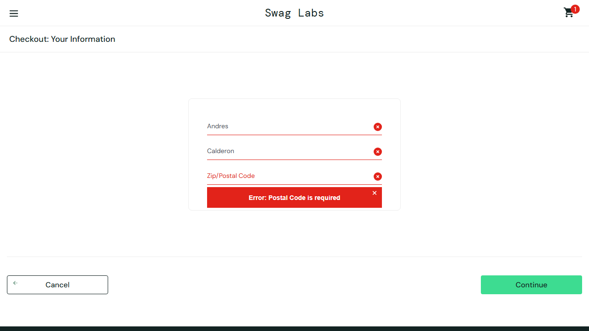

# Laboratorio de Automatización de Pruebas E2E con Playwright y TypeScript

## 👤 Datos del Estudiante
- **Nombre:** andres calderon
- **Asignatura:** Ingeniería de Software III
- **Docente:** Ing. John Alexander Pardo González
- **Herramientas:** Playwright, TypeScript, Node.js, Visual Studio Code, Git/GitHub

---

## 1. 📖 Contexto del Proyecto
En este laboratorio se diseñó e implementó un conjunto integral de **pruebas automatizadas de interfaz gráfica (End-to-End - E2E)** aplicando las mejores prácticas de la industria y los lineamientos vistos en clase:

- **Framework de pruebas:** Playwright configurado con TypeScript para tipado estático y robustez.
- **Selectores semánticos y de prueba:** Uso de atributos dedicados de testing (`data-test`, `getByRole`, selectores contextuales y de texto).
- **Estructuración y modularización:** Organización por suites temáticas (`test.describe`), precondiciones desacopladas (`test.beforeEach`) y aserciones web explícitas (`toHaveURL`, `toBeVisible`, `toHaveText`, `toContainText`, `toHaveCount`).
- **Validaciones de lógica de negocio:** Control de acceso, decremento/incremento reactivo de contadores en el carrito, verificación algorítmica de ordenamiento por precio y cálculo de totales en checkout.
- **Generación automática de evidencias:** Capturas de pantalla (`screenshots`) almacenadas por caso de prueba y reportería en formato HTML.

---

## 2. 🌐 Aplicación Seleccionada: SauceDemo (Swag Labs)
Para este proyecto se seleccionó la plataforma **[SauceDemo (Swag Labs)](https://www.saucedemo.com/)**, desarrollada por **Sauce Labs**.

### ¿Por qué esta plataforma?
1. **Estándar de la Industria y Ámbito Académico:** Es la aplicación de referencia global utilizada en cursos universitarios de Ingeniería de Software, certificaciones QA (ISTQB, Selenium Conf) y pruebas técnicas profesionales para automatización web.
2. **Flujo de Negocio Completo (E-commerce real):** A diferencia de simples formularios estáticos, simula un ciclo comercial completo: inicio de sesión multi-rol, catálogo dinámico de productos, filtros de ordenamiento, persistencia en carrito de compras y checkout transaccional en múltiples pasos.
3. **Manejo de Casos de Borde y Excepciones:** Cuenta con usuarios con comportamientos preconfigurados (usuario estándar, usuario bloqueado/suspendido, validaciones de campos requeridos), permitiendo cubrir tanto flujos felices (*happy paths*) como caminos alternos y de error.
4. **Alta Estabilidad y Confiabilidad:** Posee atributos semánticos estables (`data-test`), sin interferencia de CAPTCHAs aleatorios ni bloqueos anti-bot que introduzcan *flakiness* (inestabilidad) en las pruebas automatizadas.

---

## 3. 📝 Historias de Usuario

### HU-01: Autenticación y Control de Acceso
> **Como** usuario del portal SauceDemo  
> **Quiero** autenticarme mediante usuario y contraseña  
> **Para** acceder a las funcionalidades del catálogo y asegurar el cierre de sesión adecuado.

- **Criterio 1 (Login exitoso):** Ingresando credenciales válidas (`standard_user`), el sistema redirige a `/inventory.html`, visualizando el catálogo de productos.
- **Criterio 2 (Usuario bloqueado):** Ingresando el usuario `locked_out_user`, el sistema impide el acceso y muestra la alerta `"Epic sadface: Sorry, this user has been locked out."`.
- **Criterio 3 (Contraseña errónea):** Con clave inválida, se presenta el mensaje `"Epic sadface: Username and password do not match any user in this service"`.
- **Criterio 4 (Campos obligatorios vacíos):** Al enviar el formulario sin diligenciar campos, se muestra `"Epic sadface: Username is required"`.
- **Criterio 5 (Logout seguro):** Desde el menú lateral hamburguesa, al hacer clic en "Logout", se finaliza la sesión y se retorna a la pantalla principal.

---

### HU-02: Gestión de Catálogo y Carrito de Compras
> **Como** cliente de la tienda  
> **Quiero** explorar los artículos, ordenarlos por precio y gestionar el carrito  
> **Para** seleccionar los productos deseados antes de la compra.

- **Criterio 1 (Agregar al carrito):** Al presionar "Add to cart" en un producto, el botón conmuta a "Remove" y la insignia numérica del carrito incrementa su valor.
- **Criterio 2 (Remover del carrito):** Al pulsar "Remove", el botón regresa a "Add to cart" y la insignia del carrito disminuye de forma reactiva.
- **Criterio 3 (Ordenamiento por precio):** Al aplicar el filtro `Price (low to high)`, los productos se reorganizan de forma estrictamente ascendente por su valor monetario.

---

### HU-03: Proceso de Compra y Checkout End-to-End
> **Como** comprador en el sitio  
> **Quiero** completar el formulario de compra con mis datos de despacho y confirmar el pedido  
> **Para** recibir mis productos satisfactoriamente.

- **Criterio 1 (Checkout exitoso):** Al avanzar desde el carrito, ingresar los datos de envío (Nombre, Apellido, Código Postal), revisar el desglose de precios (Subtotal, Tax, Total) y finalizar, el sistema emite la confirmación `"Thank you for your order!"` y `"Your order has been dispatched"`.
- **Criterio 2 (Validación de datos obligatorios):** Si se omite el código postal en el checkout, el sistema retiene el avance e informa `"Error: Postal Code is required"`.

---

## 4. 🧪 Matriz de Casos de Prueba

| ID | HU | Nombre del Caso de Prueba | Datos de Entrada | Resultado Esperado | Estado |
|:---:|:---:|---|---|---|:---:|
| **CP-01** | HU-01 | Login exitoso con credenciales estándar | `standard_user` / `secret_sauce` | Redirección a `/inventory.html` con 6 productos | ✅ Pasó |
| **CP-02** | HU-01 | Login bloqueado con usuario suspendido | `locked_out_user` / `secret_sauce` | Alerta de usuario bloqueado visible en pantalla | ✅ Pasó |
| **CP-03** | HU-01 | Login fallido con contraseña incorrecta | `standard_user` / `PasswordErroneo123!` | Alerta de credenciales que no coinciden | ✅ Pasó |
| **CP-04** | HU-01 | Login fallido con campos obligatorios vacíos | Clic en Login sin datos | Alerta "Username is required" | ✅ Pasó |
| **CP-05** | HU-01 | Cierre de sesión (Logout) desde menú lateral | Clic en botón "Logout" tras login | Regresa a `/` y muestra formulario de login | ✅ Pasó |
| **CP-06** | HU-02 | Agregar productos y verificar contador | Clic en agregar Backpack y Bike Light | Botones en estado "Remove" e insignia en `2` | ✅ Pasó |
| **CP-07** | HU-02 | Remover producto y verificar decremento | Remover Bike Light con 2 items previos | Insignia decrece a `1` y botón vuelve a "Add to cart" | ✅ Pasó |
| **CP-08** | HU-02 | Ordenar productos por precio (menor a mayor) | Filtro `lohi` seleccionado | Precios ordenados ascendentemente ($7.99 a $49.99) | ✅ Pasó |
| **CP-09** | HU-03 | Compra completa End-to-End exitosa | Producto en carrito + datos de cliente | Pantalla final con "Thank you for your order!" | ✅ Pasó |
| **CP-10** | HU-03 | Validación de campos obligatorios en Checkout | Nombre y Apellido sin Postal Code | Mensaje "Error: Postal Code is required" | ✅ Pasó |

---

## 5. 📸 Evidencias de Ejecución

### Módulo HU-01: Autenticación y Control de Acceso
#### CP-01: Login exitoso


#### CP-02: Usuario bloqueado (locked_out_user)


#### CP-03: Contraseña incorrecta


#### CP-04: Campos obligatorios vacíos


#### CP-05: Logout exitoso


---

### Módulo HU-02: Gestión de Catálogo y Carrito
#### CP-06: Agregar productos al carrito


#### CP-07: Remover producto del carrito


#### CP-08: Ordenamiento por precio (Low to High)


---

### Módulo HU-03: Proceso de Compra y Checkout E2E
#### CP-09: Compra completa E2E confirmada


#### CP-10: Validación de formulario de Checkout (Postal Code requerido)


---

## 6. 📁 Estructura del Proyecto

```text
laboratorio-playwright/
├── evidencias/                  # Capturas de pantalla generadas automáticamente
│   ├── CP-01-login-exitoso.png
│   ├── CP-02-usuario-bloqueado.png
│   ├── CP-03-password-invalido.png
│   ├── CP-04-campos-vacios.png
│   ├── CP-05-logout-exitoso.png
│   ├── CP-06-agregar-carrito.png
│   ├── CP-07-remover-carrito.png
│   ├── CP-08-ordenar-precio.png
│   ├── CP-09-compra-exitosa.png
│   └── CP-10-checkout-campos-requeridos.png
├── tests/                       # Especificaciones de prueba automatizadas
│   ├── auth.spec.ts             # Pruebas de autenticación y sesión (HU-01)
│   ├── cart.spec.ts             # Pruebas de catálogo, filtros y carrito (HU-02)
│   └── checkout.spec.ts         # Pruebas del flujo de compra E2E (HU-03)
├── package.json                 # Metadatos del proyecto y scripts de ejecución
├── playwright.config.ts         # Configuración central de Playwright (Chromium, baseURL, reportes)
└── README.md                    # Documentación académica del laboratorio
```

---

## 7. 🚀 Cómo Ejecutar las Pruebas Localmente

### Prerrequisitos
- Tener instalado **Node.js** (versión 18 o superior).
- Clonar este repositorio:
  ```bash
  git clone https://github.com/AndresCalCan/laboratorio-playwright.git
  cd laboratorio-playwright
  ```

### Instalación de dependencias
```bash
npm install
npx playwright install chromium
```

### Comandos de ejecución
- **Ejecutar todos los casos de prueba (modo headless):**
  ```bash
  npm test
  ```
- **Ejecutar visualizando el navegador en tiempo real (modo headed):**
  ```bash
  npm run test:headed
  ```
- **Ejecutar en la interfaz interactiva oficial de Playwright:**
  ```bash
  npm run test:ui
  ```
- **Consultar el reporte interactivo HTML:**
  ```bash
  npm run test:report
  ```
