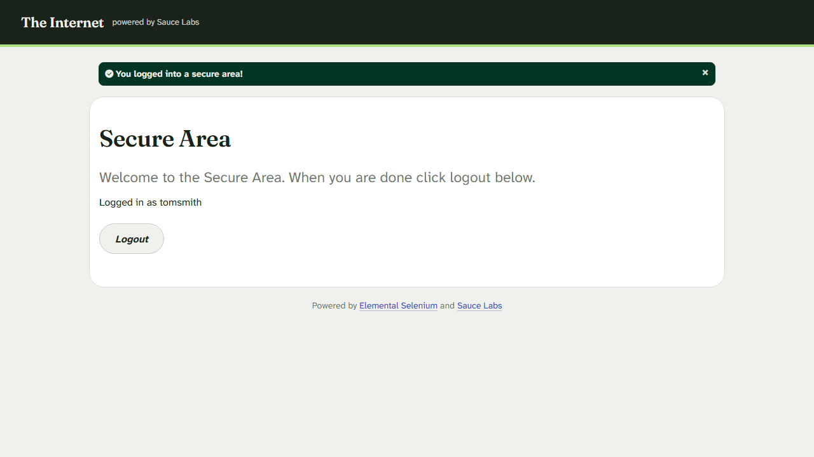
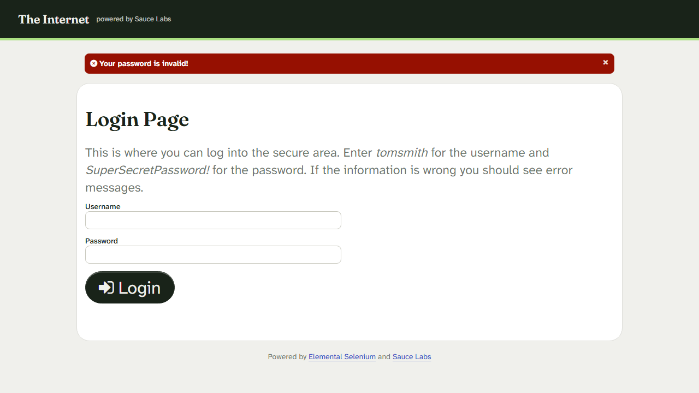
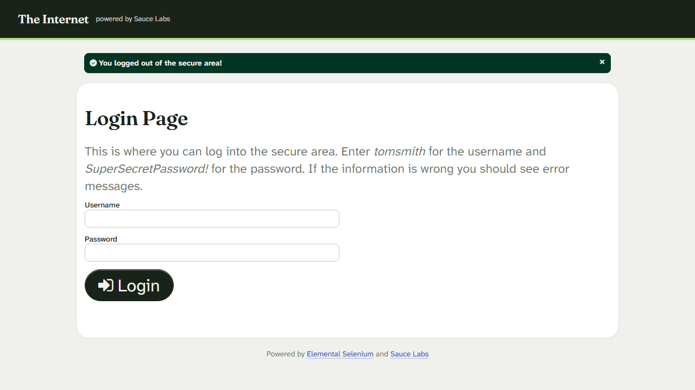

# Laboratorio de Automatización de Pruebas con Playwright y TypeScript

## 👤 Datos del Estudiante
- Nombre: andres calderon
- Asignatura: Ingeniería de Software III
- Docente: Ing. John Alexander Pardo González
- Herramientas: Playwright, TypeScript, Node.js, Visual Studio Code, Git/GitHub

---

 1. 📖 Contexto del Proyecto
En este proyecto se implementaron pruebas automatizadas de interfaz gráfica (E2E) aplicando los conceptos trabajados en clase hasta la organización de pruebas:
- Configuración del entorno de automatización con Playwright y TypeScript.
- Localizadores semánticos recomendados (`getByRole`, `getByLabel`, `locator`).
- Organización de pruebas mediante `test.describe` y precondiciones con `test.beforeEach`.
- Aserciones web automáticas (`toHaveURL`, `toContainText`, `toBeVisible`).
- Captura de evidencias visuales (screenshots) al finalizar cada caso de prueba.

---

## 2. 🌐 Aplicación Seleccionada
Para el desarrollo del taller se utilizó la plataforma de pruebas **[The Internet (Herokuapp) - Form Authentication](https://the-internet.herokuapp.com/login)**.
- **Razón de elección:** Es una aplicación pública diseñada para testing que cuenta con formularios de autenticación estables, respuestas visuales claras (mensajes de éxito y error con alertas dinámicas) y no posee bloqueos antibot ni captchas.

---

## 3. 📝 Historias de Usuario

### HU-01: Autenticación y Cierre de Sesión en el Portal
> **Como** usuario registrado del sistema  
> **Quiero** ingresar mis credenciales en el formulario de inicio de sesión  
> **Para** acceder de forma segura a mi área personal y poder cerrar sesión cuando lo requiera.  

**Criterios de Aceptación:**
- **Escenario 1 (Login exitoso):** Dado que estoy en la página de login, cuando ingreso usuario y contraseña correctos, entonces el sistema me redirige a la zona segura (`/secure`) y muestra un mensaje de bienvenida.
- **Escenario 2 (Contraseña errónea):** Dado que estoy en la página de login, cuando ingreso un usuario válido pero una contraseña equivocada, entonces el sistema me mantiene en `/login` y muestra un mensaje de advertencia "Your password is invalid!".
- **Escenario 3 (Usuario no registrado):** Dado que estoy en la página de login, cuando ingreso un nombre de usuario que no existe, entonces el sistema me mantiene en `/login` y muestra un mensaje de advertencia "Your username is invalid!".
- **Escenario 4 (Cierre de sesión):** Dado que inicié sesión exitosamente, cuando hago clic en el botón "Logout", entonces el sistema me redirige de nuevo a `/login` y muestra un mensaje confirmando el cierre de sesión.

---

## 4. 🧪 Matriz de Casos de Prueba

| ID | HU | Nombre del Caso | Datos de Entrada | Resultado Esperado | Estado |
|---|---|---|---|---|:---:|
| **CP-01** | HU-01 | Login exitoso con credenciales correctas | `tomsmith` / `SuperSecretPassword!` | Redirige a `/secure` y muestra alerta de éxito | ✅ Pasó |
| **CP-02** | HU-01 | Login fallido con contraseña incorrecta | `tomsmith` / `PasswordIncorrecta123` | Permanece en `/login` y muestra "Your password is invalid!" | ✅ Pasó |
| **CP-03** | HU-01 | Login fallido con usuario no registrado | `usuario_falso` / `SuperSecretPassword!` | Permanece en `/login` y muestra "Your username is invalid!" | ✅ Pasó |
| **CP-04** | HU-01 | Cerrar sesión (Logout) correctamente | Clic en botón "Logout" tras login | Redirige a `/login` y confirma cierre de sesión | ✅ Pasó |

---

## 5. 📸 Evidencias de Ejecución

### CP-01: Login exitoso


### CP-02: Login fallido - Contraseña incorrecta


### CP-03: Login fallido - Usuario no registrado


### CP-04: Cerrar sesión (Logout)


---

## 6. 🚀 Cómo Ejecutar las Pruebas Localmente

### Prerrequisitos
- Tener instalado **Node.js** (versión 18 o superior).
- Clonar este repositorio en tu equipo:
  ```bash
  git clone https://github.com/AndresCalCan/laboratorio-playwright.git
cd laboratorio-playwright
  ```

### Instalación de dependencias
```bash
npm install
npx playwright install chromium
```

### Comandos de ejecución
- **Ejecutar todas las pruebas en segundo plano (headless):**
  ```bash
  npx playwright test
  ```
- **Ejecutar viendo el navegador en tiempo real:**
  ```bash
  npx playwright test --headed
  ```
- **Ejecutar en modo interactivo (UI Mode):**
  ```bash
  npx playwright test --ui
  ```
- **Ver el reporte HTML generado:**
  ```bash
  npx playwright show-report
  ```

---

## 7. 🛠️ Dificultades Encontradas y Soluciones
1. **Manejo de selectores en los mensajes de alerta:**  
   *Dificultad:* El banner de mensaje (`#flash`) contenía espacios adicionales y caracteres de salto de línea generados por el botón de cierre de alerta en el DOM.  
   *Solución:* Se utilizó `.toContainText('...')` en lugar de una comparación exacta con `.toHaveText('...')`, logrando que la aserción fuera robusta y no fallara por espacios en blanco.
2. **Independencia de las pruebas:**  
   *Dificultad:* Si un caso dejaba la sesión abierta, el siguiente caso podía comenzar en una página inesperada.  
   *Solución:* Se utilizó el hook `test.beforeEach` para que cada prueba comience navegando directamente a `/login`, garantizando aislamiento total entre ejecuciones.

---

## 8. 💡 Conclusiones
- La automatización de pruebas con Playwright reduce drásticamente el tiempo de validación de flujos críticos de usuario (como el login y logout) comparado con la ejecución manual.
- Organizar las pruebas en bloques `describe` y precondiciones con `beforeEach` facilita la lectura del código y mantiene el principio DRY (Don't Repeat Yourself).
- Las capturas de pantalla automáticas proporcionan trazabilidad inmediata ante cualquier fallo o como evidencia formal del cumplimiento de criterios de aceptación.
